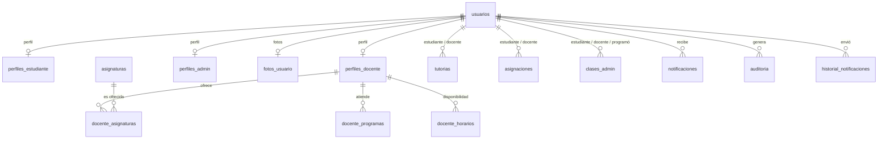

# Base de datos de ConectaProfe

PostgreSQL 16 (Railway). La aplicación crea y verifica todo al arrancar (`npm run db:init` hace lo mismo a mano): no hay que ejecutar SQL para instalarla.

## 1. Modelo de datos



| Tabla | Para qué sirve |
|---|---|
| `usuarios` | Cuenta de acceso (correo, hash de contraseña, rol, estado). Un solo rol por cuenta: estudiante, docente o admin. |
| `perfiles_estudiante`, `perfiles_docente`, `perfiles_admin` | Datos propios de cada rol (documento, programa, cédula, cargo…). Uno por usuario. |
| `fotos_usuario` | Foto de perfil y de portada en base64 (máximo 2 MB cada una, validadas al subir). |
| `asignaturas`, `docente_asignaturas` | Catálogo de materias y cuáles ofrece cada docente. |
| `docente_programas`, `docente_horarios` | Programas que atiende cada docente y su disponibilidad semanal. |
| `tutorias` | Reservas entre un estudiante y un docente (fecha, hora, modalidad, estado). |
| `asignaciones` | Vínculo estudiante-docente que gestiona la administración, con el cupo máximo por docente. |
| `clases_admin` | Clases que programa un administrador directamente. |
| `notificaciones`, `historial_notificaciones` | Avisos a cada persona y el registro de los envíos masivos. |
| `periodos`, `configuracion` | Período académico activo y reglas de negocio (promedio mínimo, horas de cancelación, cupo, minutos de sesión). |
| `auditoria` | Bitácora de eventos (inicios de sesión, cambios, reparaciones). Los eventos antiguos se archivan, no se borran. |
| `intentos_login` | Intentos de acceso para el bloqueo por fuerza bruta. Se purga cada hora (más de un día). |

## 2. Integridad que garantiza la propia base

Lo que antes solo vigilaba el código ahora lo exige PostgreSQL, así que ningún camino (ni un script, ni dos usuarios a la vez) puede dejar datos inconsistentes.

**Al borrar un usuario**: sus tutorías, asignaciones, clases, notificaciones, perfiles y fotos se borran en cascada. La auditoría, el historial de envíos y «programado por» de las clases se conservan con el usuario en `NULL`. Un docente borrado solo arrastra lo suyo (`docente_asignaturas`, `docente_programas`, `docente_horarios` caen con `perfiles_docente`).

**Índices únicos** (no admiten duplicados):

| Índice | Garantiza |
|---|---|
| `uq_usuarios_correo_minuscula` | Un correo, sin importar mayúsculas. |
| `uq_usuarios_google_id` | Una cuenta por identificador de Google. |
| `uq_tutorias_docente_horario`, `uq_tutorias_estudiante_horario` | Ni un docente ni un estudiante tienen dos tutorías vigentes (no canceladas) a la misma fecha y hora. |
| `uq_asignaciones_activa` | Una sola asignación activa por pareja estudiante-docente. |
| `uq_asignaturas_nombre_minuscula` | Una asignatura por nombre, sin importar mayúsculas. |
| `uq_perfiles_estudiante_documento`, `uq_perfiles_docente_cedula` | Un documento o cédula por persona (los vacíos no cuentan). |
| `uq_periodos_un_activo` | Un solo período activo. |

**Restricciones CHECK**: estados y modalidades válidos, `activo` y `leida` solo 0 o 1, promedio entre 0 y 5, y fechas `AAAA-MM-DD` y horas `HH:MM` con formato correcto (las tutorías canceladas quedan exentas porque son historia).

**Cómo se aplican sin riesgo.** Si al arrancar ya existen datos que incumplen una regla (por ejemplo, dos tutorías a la misma hora), la migración **no** toca ni borra nada: avisa en el log con el motivo, omite esa protección y la aplicación arranca igual. Cuando los datos se corrigen (`npm run db:reparar`), el siguiente arranque la crea sola.

## 3. Concurrencia

Dos personas reservando a la vez el mismo horario, o dos administradores quitando el último administrador, pasaban las validaciones del código al mismo tiempo. Ahora cada operación sensible toma un bloqueo de aviso de PostgreSQL dentro de su transacción, siempre en el mismo orden para evitar interbloqueos:

| Clave | Recurso que serializa |
|---|---|
| 7000 | Migración al arrancar (dos instancias de un despliegue con solapamiento esperan su turno). |
| 7001 | Gestión de administradores (nunca se queda el sistema sin uno activo). |
| 7002 / 7003 | Agenda de un docente / de un estudiante (por su `id`). |
| 7004 | Cupo de estudiantes de un docente. |
| 7005 | Períodos académicos. |

Las operaciones de varios pasos (programar una clase, guardar el perfil de un docente, enviar notificaciones con su historial) van en una sola transacción: o se guarda todo o nada.

## 4. Rendimiento

- Toda clave foránea tiene su índice (acelera borrados en cascada y uniones). Las listas ordenadas por fecha tienen índices compuestos (`estudiante_id, fecha DESC`, `docente_id, fecha DESC`, `creada_en DESC`).
- Los listados del panel de administración se paginan en el servidor (`limite`, `pagina`, cabecera `X-Total-Count`) y filtran en SQL.
- `npm run db:diagnostico` revisa claves sin índice, índices repetidos o sin uso, filas muertas, tamaño de tablas y porcentaje de lecturas en memoria.

## 5. Seguridad de los datos

- Contraseñas: bcrypt con 12 rondas (límite de 72 bytes validado). El diagnóstico detecta hashes con formato inválido, pocas rondas y cuentas con contraseñas públicas (`--profundo`).
- Las consultas usan parámetros (`$1`, `$2`…): ninguna entrada del usuario se concatena en SQL. Los `LIKE` escapan `%` y `_`.
- Las fotos son lo más pesado de la base. Si el uso crece, lo recomendable es moverlas a un almacenamiento de archivos y guardar solo la URL.
- Las copias de seguridad contienen datos personales y hashes: se guardan con permisos privados y la carpeta `respaldos/` está en `.gitignore`.
- Recomendado cuando sea posible: que la aplicación use un rol con solo los permisos necesarios en lugar del superusuario de Railway.

```sql
CREATE ROLE conectaprofe_app LOGIN PASSWORD '…';
GRANT CONNECT ON DATABASE railway TO conectaprofe_app;
GRANT USAGE ON SCHEMA public TO conectaprofe_app;
GRANT SELECT, INSERT, UPDATE, DELETE ON ALL TABLES IN SCHEMA public TO conectaprofe_app;
GRANT USAGE, SELECT ON ALL SEQUENCES IN SCHEMA public TO conectaprofe_app;
-- La migración necesita crear tablas e índices: córrela con el rol administrador y la aplicación con este.
```

## 6. Migraciones

`src/config/migrate.js` aplica, bajo el bloqueo 7000, estos pasos idempotentes: crear tablas → índices → ajustar columnas → corregir claves foráneas → administrador inicial → período y configuración → protecciones de integridad → catálogo de asignaturas → cuentas de ejemplo (solo fuera de producción). Reglas para agregar cambios:

1. Siempre idempotentes (`IF NOT EXISTS`, `ADD COLUMN IF NOT EXISTS`, comprobar antes de crear).
2. Nunca borrar ni reescribir datos automáticamente. Si una regla nueva puede chocar con datos existentes, créala desde `esquema.js` como índice o restricción «segura» (se omite con aviso si hay conflictos).
3. Probar el cambio en `tests/backend-esquema.test.js`: cada prueba corre sobre una base temporal que se crea y se borra sola.

## 7. Respaldo y restauración

Los comandos no necesitan `pg_dump`: funcionan igual en Windows, macOS y Linux.

```bash
npm run db:respaldo                      # crea respaldos/respaldo_AAAAMMDD_HHMMSS.json.gz y lo verifica
npm run db:respaldo -- --conservar=10    # además deja solo los 10 más recientes
npm run db:restaurar -- archivo.json.gz --solo-verificar   # comprueba el archivo sin tocar ninguna base
```

Cada archivo guarda todas las tablas (excepto `intentos_login`), el tipo exacto de cada columna y una huella SHA-256. Antes de restaurar se comprueba que el archivo esté completo y sin modificar; una copia cortada, alterada o con SQL escondido se rechaza.

**Contra la base de Railway desde tu computador**

1. En Railway, entra al servicio **Postgres → Variables** y copia el valor de `DATABASE_PUBLIC_URL`. No la pegues en chats ni la subas a GitHub: lleva la contraseña.
2. En la carpeta del proyecto abre una terminal y ejecuta (PowerShell):
   ```powershell
   $env:DATABASE_PUBLIC_URL = "<pega aquí la URL>"
   npm run db:respaldo
   ```
3. Guarda el archivo de `respaldos/` en un lugar privado (no en el repositorio).
4. Haz esto **antes de cada despliegue** y de cualquier `npm run db:reparar -- --aplicar`.

**Restaurar**

- A una base nueva y vacía: `npm run db:restaurar -- archivo.json.gz` (crea las tablas y carga los datos).
- Sobre una base con datos: `npm run db:restaurar -- archivo.json.gz --reemplazar --confirmar`. Antes guarda una copia automática de lo que había (`previo-restauracion_…`) y hace todo en una sola transacción: si algo falla, la base queda como estaba.
- Después de restaurar, **cambia `JWT_SECRET`** en Railway: cierra todas las sesiones y evita que un token viejo apunte a otra persona.

## 8. Diagnóstico y reparación

```bash
npm run db:diagnostico                  # solo lectura; código de salida 1 si hay errores de integridad
npm run db:diagnostico -- --profundo    # además busca cuentas con contraseñas publicadas
npm run db:diagnostico -- --sql         # imprime las consultas para pegarlas en la pestaña Query de Railway

npm run db:reparar                      # muestra qué cambiaría; no modifica nada
npm run db:reparar -- --aplicar         # copia previa automática + cambios en una transacción
npm run db:reparar -- --aplicar --limpiar-documentos   # además vacía documentos/cédulas repetidos (los más nuevos)
```

Niveles del diagnóstico: ✅ correcto, ℹ️ informativo, ⚠️ aviso (conviene revisarlo), ❌ error (los datos incumplen una regla de integridad).

La reparación **nunca borra filas**: las tutorías repetidas o con fecha imposible se marcan como `cancelada` (con el motivo en `observaciones` y un aviso a las dos personas), las asignaciones repetidas pasan a `removida`, y todo queda en la auditoría. Lo que no se puede resolver sin inventar datos (correos repetidos, períodos activos duplicados, tutorías completadas repetidas) se lista como decisión humana. Si algo no te convence, restauras la copia previa.

## 9. Pruebas

| Archivo | Qué comprueba |
|---|---|
| `tests/backend-esquema.test.js` | Cada índice único y restricción rechaza lo que debe, borrados en cascada, migración sobre datos sucios, migraciones simultáneas. |
| `tests/backend-mantenimiento.test.js` | Respaldo y restauración idénticos fila por fila, archivos manipulados, diagnóstico, reparación reversible y los comandos reales. |
| `tests/backend-reservas.test.js` | Reservas y cupos simultáneos. |

Todas usan bases temporales y se niegan a correr contra Railway.

## 10. Pendientes recomendados

- **Fechas como texto.** `fecha`, `hora` y `creada_en` son `TEXT` (`AAAA-MM-DD`, `HH:MM`). Está protegido por restricciones de formato, pero convertirlos a `DATE`/`TIME`/`TIMESTAMPTZ` permitiría operar con intervalos en SQL. Es una migración con impacto en el código: hacerla en una versión aparte.
- **Archivo de auditoría y notificaciones.** La auditoría ya se archiva desde el panel; las notificaciones leídas de hace más de un año se podrían archivar igual cuando haya volumen.
- **Verificación de correo** al registrarse y **fotos en almacenamiento de archivos**.
- **Respaldo automático programado** (por ejemplo, una tarea semanal de Railway que ejecute `npm run db:respaldo` y suba el archivo a un almacenamiento externo).
